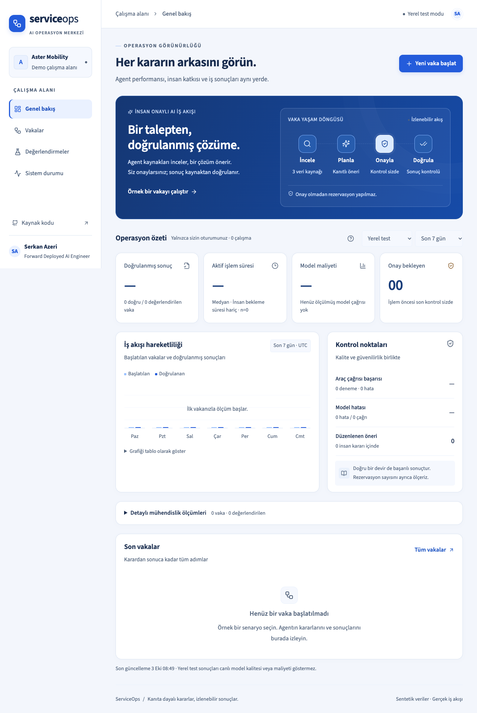
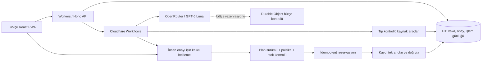

# ServiceOps

**İnsan onaylı, kanıta dayalı ve ölçülebilir servis operasyonları agentı.**


[English](README.en.md) · [Mimari kararlar](docs/architecture.md) · [Metrik sözlüğü](docs/metrics.md) · [Değerlendirme yöntemi](docs/evaluation.md) · [İşletim rehberi](docs/operations.md)

ServiceOps, bir Forward Deployed AI Engineer'ın iş problemini çalışan ve denetlenebilir bir sisteme dönüştürme yaklaşımını gösterir. Kurgusal **Aster Mobility** şirketinin geciken servis vakalarını inceler; müşteri kaydı, stok ve politikadan kanıt toplar; çözüm önerir; gerekli insan onayından sonra rezervasyon yapar ve sonucu veritabanından tekrar okuyarak doğrular.

> **Durum:** Yerel iş akışı ve politika testleri uygulanmıştır. Canlı yayın ve OpenRouter değerlendirme sonuçları, gerçek dağıtım doğrulandıktan sonra burada yayımlanır. Yerel test sağlayıcısı çıktıları LLM başarısı olarak sunulmaz.



## Neden bu problem?

Servis gecikmesi tek bir metin yanıtıyla kapanmaz. Doğru araç kimliği, güncel stok, garanti koşulları, müşteri iletişimi ve birden fazla sistemde tutarlı değişiklik gerekir. Başarı, agentın akıcı bir öneri yazmasıyla değil, doğru ve izin verilmiş işlemin gerçekleşmesiyle ölçülür.

Bu projede öne çıkan mühendislik soruları:

- Model doğru aracı seçti mi ve kararını gerçek kaynaklara bağladı mı?
- Stok onay beklerken değişirse ne olur?
- Aynı onay iki kez gelirse ikinci rezervasyon engellenir mi?
- Geçici hata ile kalıcı iş kuralı ihlali farklı ele alınıyor mu?
- İnsan bekleme süresi, model gecikmesi ve iş sonucu ayrı ölçülüyor mu?
- Başarısız veya maliyeti bilinmeyen çağrılar raporda görünür mü?

## Deneyim

1. Türkçe bir servis senaryosu seçin.
2. Kaynak okuma ve araç çağrılarını yürütme günlüğünde izleyin.
3. Öneriyi, kanıtlarını ve müşteri mesajı taslağını inceleyin.
4. Onaylayın, izin verilen başka bir işlemi seçin veya reddedin.
5. Rezervasyonun ve stok değişiminin doğrulandığını görün.
6. Dashboard'da kendi oturumunuzun sonuçlarını, sürelerini ve maliyetlerini inceleyin.

**8 senaryo ailesi:** merkezden tedarik, alternatif şube, ikame araç, eksik kimlik, çelişen politika, kaynak yokluğu, onay sırasında stok değişimi ve geçici araç hatası. Her biri için 5 varyant, toplam **40 sürümlenmiş sentetik senaryo** bulunur. Eksik bilgi senaryosu güvenli bilgi isteme durumunda sonlanır; bilgi tamamlandıktan sonra yeni vaka başlatılır.

Veriler sentetiktir. Rezervasyonlar izole demo kayıtlarında gerçekten saklanır. Gerçek müşteriye mesaj gönderilmez, gerçek araç/parça rezerve edilmez. Her ziyaretçinin verisi ayrı bir oturuma bağlıdır.

## Mimari



| Tercih                      | Gerekçe                                                              | Kabul edilen karşılık                                                 |
| --------------------------- | -------------------------------------------------------------------- | --------------------------------------------------------------------- |
| React + TypeScript + Vite   | Etkileşimli operasyon arayüzü, tip güvenliği, küçük üretim derlemesi | İlk içerik için JavaScript gerekir; kamuya açık SEO ürünü hedeflenmez |
| Workers + Hono              | API ve statik arayüz tek dağıtımda                                   | Edge çalışma zamanı sınırlarına uyum gerekir                          |
| Cloudflare Workflows        | Kalıcı adımlar, tekrar deneme, 24 saat onay bekleme                  | Orkestrasyon Cloudflare'a bağlı; iş kuralları ayrı saf modülde        |
| D1                          | Düşük hacimli demo için SQL, indeksler ve atomik batch işlemleri     | Büyük analitik iş yükleri için ayrı veri hattı gerekir                |
| Durable Objects             | Eşzamanlı çağrılarda ortak bütçe rezervasyonu                        | Bir global bütçe nesnesi bu demo ölçeğine göre seçildi                |
| OpenRouter                  | Mevcut krediler ve değiştirilebilir sağlayıcı/model                  | Sağlayıcı hataları ve kullanım raporu eksikliği yönetilmeli           |
| GPT-6 Luna                  | Düşük maliyetli başlangıç adayı, araç çağırma                        | Uygulamaya özgü canlı test geçmeden kalite iddiası yok                |
| Tek, sınırlandırılmış agent | Bu görevde izlenebilir karar ve kontrollü araç kullanımı yeterli     | Çok agentlı organizasyon ve Paperclip bu kapsamda kullanılmaz         |

## Hızlı başlangıç

Node.js **22.12+** gereklidir. İlk çalışma için bulut hesabı veya API anahtarı gerekmez.

```bash
npm ci
cp .env.example .dev.vars
npm run db:local
npm run check
npm run preview
```

Uygulama `http://localhost:8788` adresinde açılır. Varsayılan `MODEL_MODE=fixture`, gerçek D1 ve Workflows üzerinde deterministik bir test sağlayıcısı çalıştırır. Arayüzde açıkça **Yerel test modu** yazılır. Geliştirme sırasında `npm run dev` arayüzü `http://localhost:5174` üzerinden sunar.

Canlı modele geçmek için `.dev.vars` içinde `OPENROUTER_API_KEY` ve `MODEL_MODE=live` ayarlayın. Anahtar tarayıcıya gönderilmez. Üretim ortamı fixture modunda yeni vaka çalıştırmayı reddeder.

## Doğrulama

```bash
npm test                  # İş kuralları, yetki sınırları ve metrik matematiği
npm run evaluate          # 40 deterministik politika senaryosu; LLM çağrısı yok
npm run build             # TypeScript + üretim paketi + PWA
npx playwright install chromium
npm run test:e2e           # Gerçek yerel D1/Workflows ve tarayıcı testleri
```

Uçtan uca testler 8790 portunda ayrı, geçici D1/Workflow/bütçe durumu ve boş anahtarlarla başlar. Mac'te kurulu Chrome kullanılabilir; CI Playwright Chromium kullanır. Uçtan uca testler; zorunlu onay, mükerrer karar, değişen stok, ret, timeout kurtarma, oturum izolasyonu, Türkçe arayüz, responsive genişlikler ve çevrimdışı uygulama kabuğunu kapsar. Testler gerçek dış servislere yazmaz ve OpenRouter kredisi harcamaz.

Canlı değerlendirme ayrı ve bütçe kontrollüdür:

```bash
# EVALUATION_TOKEN, .dev.vars ve sunucuda aynı secret olmalı.
npm run evaluate:live -- --url https://YOUR_WORKER.workers.dev --limit 40 --publish
```

Rapor model/prompt/veri seti sürümü, veri seti hash'i, deneme sayısı, sağlayıcı, maliyet, süre ve başarısızlıkları içerir. Model testleri veya insan değerlendirmesi çalıştırılmadan bunlara ait başarı yüzdesi yayımlanmaz. [Yöntem ve sınırlar →](docs/evaluation.md)

## Ölçüm yaklaşımı

Dashboard ziyaretçinin kendi oturumundaki, seçili dönemde **başlatılmış** vakaların güncel durumunu ölçer. Canlı ve fixture trafik ayrıdır. Değerlendirme trafiği ziyaretçi dashboard'una dahil edilmez.

- **Doğrulanmış sonuç:** kaynak sonrası kontrolü geçen sonuç / kontrol yapılmış vaka. Uygun devir ve eksik bilgi isteme de doğru sonuç olabilir.
- **Tamamlanan rezervasyon:** doğrulanmış yazma işlemi; devir ve ret dahil değildir.
- **Süre:** aktif süre, insan bekleme süresi ve toplam süre ayrı; p50/p95 ve örneklem sayısı birlikte.
- **Maliyet:** başarısız denemeler dahil raporlanmış tutar; eksik kullanım raporları sıfır kabul edilmez.
- **Çözüm başına maliyet:** kohorttaki tüm çağrı maliyetleri / doğrulanmış rezervasyonlar; yalnızca kapsam tam ise.

Metrikler için sıfır örneklem `—` olarak görünür. Manuel çalışma süresi ölçülmediği için tasarruf/ROI iddiası bulunmaz. [Tüm tanımlar →](docs/metrics.md)

## İşlem güvenliği ve dayanıklılık

- Model yalnızca kaynak okuyabilir ve öneri sunabilir. Yazma işlemi sunucu iş kuralları ve sürüme bağlı insan onayı gerektirir.
- Araç argümanları ve öneriler Zod ile doğrulanır. Müşteri notları talimat değil, güvenilmeyen kaynak verisidir.
- Her model/araç çağrısı Workflow adımıdır. Model en fazla 8 tur çalışır; yeniden planlama en fazla 3 plan sürümü üretir.
- Rezervasyon anahtarı vaka kimliğidir. D1 transaction ve unique constraint mükerrer kaydı engeller. Harici sistemler için evrensel “exactly once” garantisi iddia edilmez.
- Eski stok sürümüyle onay uygulanmaz. Onay 24 saatte sona erer; zaman aşımı onay yerine geçmez.
- HttpOnly, SameSite oturumu; üretimde Secure cookie; same-origin JSON yazma istekleri; her vaka erişiminde sahiplik kontrolü.
- Model çıktısı HTML olarak işlenmez. CSP uygulanır. API yanıtları ve oturum bilgileri service worker önbelleğine yazılmaz.

## Performans ve PWA

Mobil, tablet ve masaüstü için responsive düzen; kurulabilir manifest ve maskable ikonlar; sürümlü uygulama kabuğu önbelleği. Çevrimdışıyken kabuk ve bağlantı durumu açılır. Agent ve onay işlemleri çevrimiçi çalışır; çevrimdışı yazma kuyruğu yoktur. Yeni service worker mevcut oturumu zorla devralmaz.

Türkçe karakter destekli Source Sans 3 fontu yerel sunulur. Gövde metinleri çoğunlukla 16–17 px, yardımcı metinler 14–15 px boyutundadır; mavi/lacivert palet ve açık yüzeyler kullanılır. Kullanılmayan alfabe dosyaları pakete alınmaz. API listeleri sayfalanır, D1 sorguları indekslidir. Gizli sekmede arka plan polling yapılmaz. Web Vitals p75 ölçümleri oturum bazında toplanır; hedefler LCP ≤2,5 sn, INP ≤200 ms, CLS ≤0,1. Hedef ile doğrulanmış saha sonucu ayrı tutulur.

## Bütçe ve dağıtım

Varsayılan sınırlar: **$1/gün**, **$10/ay**, değerlendirme için ayrıca **$5 toplam**. Değerlendirme çağrıları günlük/aylık sınırları da tüketir. Her model denemesinden önce $0,01 ayrılır; raporlanan maliyetle uzlaştırılır. Maliyeti bilinmeyen timeout çağrısının rezervasyonu korunur. Bu sayaçlar uygulama kontrolüdür; sağlayıcı faturası ayrıca doğrulanmalıdır.

Ziyaretçi başına günde 10, IP başına 20, tüm demo için 50 vaka sınırı vardır. Cloudflare kotaları hesap genelinde paylaşılır; Free plan için yük altında CPU ve adım sayısı ayrıca ölçülmelidir. [Cloudflare dağıtımı, secret yönetimi ve geri alma →](docs/operations.md)

## Kapsam sınırları

Bu, üretim yaklaşımını gösteren bir referans uygulamadır. Gerçek CRM/ERP bağlantısı, kurumsal SSO/rol yönetimi, bağımsız telemetri ihracı, çok kiracılı organizasyon yönetimi ve gerçek müşteri verisi işleme bu sürümün parçası değildir. Doküman arama altyapısı RAGNA'dan bağımsızdır; gelecekte bir kaynak adaptörü eklenebilir.

## Geliştirici

**[Serkan Azeri](https://www.serkanazeri.com/)** · Forward Deployed AI Engineer

Frontend, kullanıcı deneyimi ve kurumsal entegrasyon tecrübesini; kontrollü agent yürütme, değerlendirme ve işletim görünürlüğüyle birleştiren açık kaynak çalışma.

[MIT lisansı](LICENSE). Sentetik senaryolar projeye aittir; kullanılan bağımlılıkların lisansları kendi paketlerinde bulunur.
