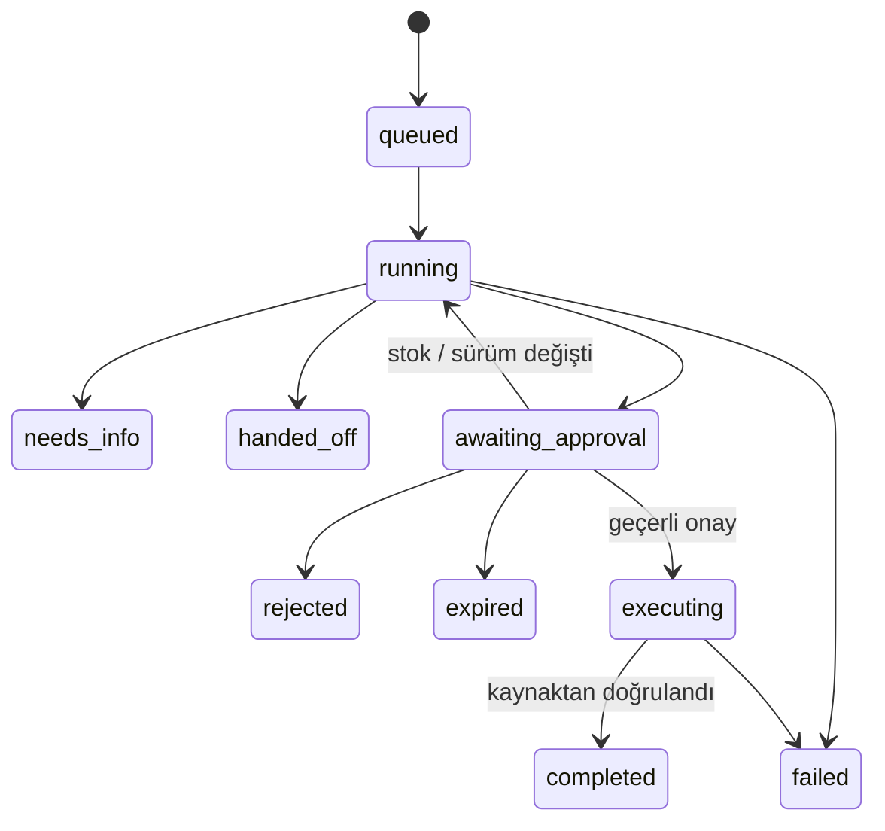

# Mimari karar kaydı

## 1. İş kuralı, öneri ve yazma yetkisi

`shared/domain.ts` saf iş kurallarını, şemaları ve sentetik senaryoları içerir. `worker/model.ts` OpenRouter adaptörüdür. `worker/workflow.ts` kaynak okuma, karar ve onay yaşam döngüsünü yürütür. `worker/index.ts` oturum sahipliği ve HTTP sınırlarını uygular.

Modelin dört aracı vardır: `get_case`, `get_inventory`, `get_policy`, `propose_resolution`. İlk üç araç yalnızca çalışmakta olan vakanın verisini döndürür; kullanıcı/model başka bir vaka kimliği belirleyemez. Dördüncü araç öneri üretir, yazma yetkisi vermez. Öneri ancak üç araç okunmuş, üç farklı kanıt verilmiş ve seçenek güncel politikaya uyuyorsa kabul edilir.

Veri eksikliği `needs_info`, politika çelişkisi veya kaynak yokluğu `handed_off` ile sonlanır. Rezervasyon öncesi insan onayı zorunludur. Müşteri mesajı bir taslaktır. Bu sürümde mesaj gönderme entegrasyonu yoktur.

## 2. Kalıcı orkestrasyon

Her model çağrısı ve araç kullanımı `step.do` içinde çalışır. Model çağrısı en fazla bir kez, veri araçları en fazla bir kez, atomik yazma adımı en fazla iki kez tekrar denenir. Bir planda 8 agent turu, bir vakada 3 plan sürümü sınırı vardır. Kalıcı iş kuralı hatalarında `NonRetryableError` kullanılır.

`waitForEvent` insan kararını en fazla 24 saat bekler. Sekmenin kapanması işlemi iptal etmez. Zaman aşımı otomatik onay sayılmaz. Olay yükü yalnızca onay kaydı kimliğini taşır; işlem seçeneği ve karar, sunucunun kaydettiği onay satırından okunur.

## 3. Tekrarlar ve tutarlılık

Workflow checkpoint'i dış işlemler için evrensel exactly-once garantisi sağlamaz. Bu nedenle:

- Vaka başlatma kimliği istemcide üretilir; aynı kimlik başka oturuma açılmaz.
- `(run_id, plan_version)` tek bir onay kaydına izin verir. Farklı karar ile tekrar 409 döner.
- İşlem kimliği vaka kimliğinden türetilir. `reservations.run_id` benzersizdir.
- Rezervasyon ekleme ve stok güncellemesi tek D1 batch transaction'ında yapılır.
- Yazmadan önce onaylanan veri sürümü tekrar okunur. Stok değişmişse yeni plan ve onay gerekir.
- Ayrı doğrulama adımı rezervasyon ile güncel vaka verisini yeniden okuyup stok farkını ve kayıt sürümünü kontrol eder.

Gerçek CRM/ERP adaptörü eklenirse hedef sistemin idempotency anahtarı, transaction sınırı, uzlaştırma API'si ve kısmi başarı/compensation davranışı ayrıca tasarlanmalıdır. Mevcut demo iki bağımsız dış sistem arasında atomiklik iddia etmez.

## 4. Cloudflare seçimi

Statik arayüz ve API tek Worker dağıtımındadır. D1 demo ölçeğinde SQL ve transaction ihtiyacını karşılar. Workflows, onay için uzun süre açık HTTP bağlantısı gerektirmez. Ortak bütçe kontrolü Durable Object storage transaction'ıyla seri hale getirilir.

Karşılık: orkestrasyon Cloudflare'a bağlıdır. Politika, şema ve metrik hesapları framework bağımsız TypeScript modüllerinde tutularak bu bağımlılığın alanı sınırlandırılır. Worker Free CPU/adım limitleri ve hesapta paylaşılan kotalar canlı yük testiyle ayrıca değerlendirilmelidir.

## 5. Gözlemlenebilirlik

Vaka kimliği tüm olayları, model denemelerini ve onayları bağlar. Model ve prompt sürümü vaka üzerinde; sağlayıcı, generation kimliği, tokenlar, süre ve maliyet her model denemesi üzerinde kaydedilir. Yeniden denenmiş başarısız çağrı silinmez.

Günlükte saklanan karar gerekçesi kısa, kullanıcıya gösterilebilir bir özettir; modelin özel düşünce zinciri değildir. Veriler sentetik olsa da API anahtarı ve yetkilendirme başlıkları günlüğe yazılmaz.

Bu sürüm D1 olay kayıtları ve Cloudflare platform logları kullanır. OpenTelemetry collector ihracı uygulanmış gibi sunulmaz. Üretimde bağımsız izleme, olay alarmı ve platform seviyesinde erişim kontrolü eklenmelidir.

## 6. Model protokolü ve maliyet sınırı

Başlangıç modeli `openai/gpt-6-luna`, OpenRouter Chat Completions üzerinden kullanılır. GPT-6 Luna bu protokolde araç çağırmak için reasoning kapalı olmasını gerektirir. Adaptör bu nedenle OpenRouter'ın ortak `reasoning: { effort: "none" }` alanını açıkça gönderir; sağlayıcının varsayılanına güvenmez. Kısa, politika ile sınırlı bu görevde kararın güvenliği sunucu doğrulamasından gelir. Model değişikliği protokol/parametre uyumu ve aynı veri seti üzerinde yeni canlı değerlendirme gerektirir.

Sağlayıcı seçimi gerekli parametre desteğini ve milyon token başına en fazla $0,10 giriş / $0,50 çıkış fiyatını şart koşar. Uygun sağlayıcı yoksa istek başarısız olur; fiyat sınırı sessizce artırılmaz. Her denemeden önce bütçe ayrılır. Gerçek kullanım raporu yoksa maliyet bilinmiyor olarak kalır. Bu yapılandırma canlı model başarısının kanıtı değildir; canlı değerlendirme raporu ayrıca yayımlanır.

3 Ekim 2026 canlı entegrasyonunda `temperature` ve `parallel_tool_calls` alanlarının `require_parameters: true` ile sağlayıcı eşleşmesini engellediği doğrulandı (HTTP 404). Adaptör yalnızca model kataloğunun ilan ettiği alanları gönderir; parametre filtresi veya fiyat tavanı gevşetilmez. Bir yanıtta birden fazla araç isteği gelirse sunucu bunları sırayla ve ayrı doğrulamayla işler. Cloudflare'ın `NonRetryableError: PROVIDER_404` gibi sarmaladığı hata mesajları, yalnızca izin verilen biçimdeki kısa hata koduna dönüştürülür. Bu sayede yapılandırma hataları değerlendirmeyi erken durdurur; ham sağlayıcı mesajları kullanıcıya açılmaz.

## Kaynaklar

- [Cloudflare: durable AI agents](https://developers.cloudflare.com/workflows/get-started/durable-agents/)
- [Cloudflare: workflow rules](https://developers.cloudflare.com/workflows/build/rules-of-workflows/)
- [OpenRouter: tool calling](https://openrouter.ai/docs/guides/features/tool-calling)
- [OpenRouter: usage accounting](https://openrouter.ai/docs/cookbook/administration/usage-accounting)
- [OpenAI: GPT-6 Luna model ve araç çağırma desteği](https://developers.openai.com/api/docs/models/gpt-6-luna)
- [OpenRouter: reasoning parametreleri](https://openrouter.ai/docs/guides/best-practices/reasoning-tokens)
- [OpenRouter: sağlayıcı seçimi ve zorunlu parametre desteği](https://openrouter.ai/docs/guides/routing/provider-selection)
