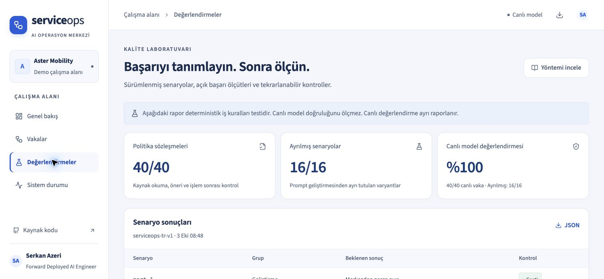

# Canlı yayın doğrulama kaydı

**Tarih:** 3 Ekim 2026 · **Demo:** [serviceops.serkanazeri.workers.dev](https://serviceops.serkanazeri.workers.dev) · **Model:** `openai/gpt-6-luna` (OpenRouter / OpenAI)

## Ölçülen sonuçlar

| Katman | Kanıt | Sonuç |
| --- | --- | --- |
| Birim testleri | `npm test` | 72/72; hata serileştirmesi ve değerlendirmeyi durdurma kontrolleri dahil |
| Deterministik politika | `npm run evaluate` | 40/40; canlı model ölçümünden ayrı |
| Yerel D1 + Workflows + tarayıcı | `npm run test:e2e` | 9/9; stok değişimi, son stok sonrası mükerrer onay, ret, izolasyon, responsive, çevrimdışı kabuk ve otomatik WCAG AA kontrolü |
| Gerçek model | [Ham JSON](../public/live-evaluation.json) | 40/40; geliştirme 24/24, ayrılmış varyantlar 16/16 |
| Gerçek model maliyeti | Aynı rapor | 99 çağrı; $0,0104944; eksik maliyet 0 |
| Canlı onay akışı | Tarayıcı ve Cloudflare Workflow sorgusu | Kaynak okuma → onay bekleme → rezervasyon → kaynaktan doğrulama; Workflow `Completed` |
| Canlı stok değişimi | [Kontrol çıktısı](release-checks.json) | Onay öncesi yazma yok; yeni plan için ikinci onay; eski onaya 409; güncel onayın tekrarına 200; tek rezervasyon; Workflow `complete` |
| HTTP / PWA | Canlı uç nokta ve tarayıcı | HTTPS, Secure + HttpOnly oturum, API `no-store`, CSP, manifest ve service worker 200; yükleme düğmesi görünür |
| Canlı mobil | Chrome, 390 px | Belge genişliği 390 px; yatay taşma yok; menü ve gezinme çalışır |

Canlı raporun sunucudaki JSON'u yereldeki yayımlanan dosyayla birebir karşılaştırıldı. 40 vaka için uçtan uca p50 **6.064 ms**, p95 **11.106 ms** (nearest-rank) ölçüldü. Bunlar otomatik değerlendirme onayı ve polling süresini içerir; gerçek operatör bekleme süresi değildir.

## Entegrasyonda bulunan ve düzeltilen sorunlar

1. **Sağlayıcı parametre uyumu:** İlk smoke isteği, katı sağlayıcı filtresiyle desteklenmeyen `temperature` / `parallel_tool_calls` alanları nedeniyle 404 aldı. Alanlar çıkarıldı; fiyat tavanı ve zorunlu parametre kontrolü korundu. Başarısız vaka silinmedi. Cloudflare hata sarmalaması için kısa hata kodu normalizasyonu eklendi.
2. **Son stok sonrası idempotent yanıt:** Rezervasyon tamamlanıp son parça tüketildiğinde aynı onayın tekrarı stok uygunluğuna yeniden bakarak 409 döndürüyordu. İkinci rezervasyon oluşmadı, ancak tekrar yanıtı doğru değildi. Aynı sürüm ve aynı kaydedilmiş karar, güncel stoktan bağımsız olarak kabul edilir; eski sürüm 409 döner. Yerel regresyon ve canlı tekrar kontrolü geçti.
3. **Arayüz durum doğruluğu:** Model yapılandırılmadan işlem başlatma kapatıldı. Başarısız ve plansız vakada “kaynaklar inceleniyor” yerine durmuş akış bilgisi gösterilir.

Tam model değerlendirmesi ilk sorunun düzeltmesinden sonra bir kez çalıştırıldı. Prompt veya veri seti, ayrılmış test sonuçlarına göre değiştirilmedi. Sonraki API idempotency düzeltmesi ayrı canlı smoke ve uçtan uca regresyonla doğrulandı. Bu ayrım, model değerlendirmesi ile API davranış doğrulamasının kapsamını açık tutar.

## Kanıt kapsamı ve işletim sınırları

- Gerçek müşteri verisi veya harici CRM/ERP yazma işlemi yoktur. Bütün iş vakaları sentetiktir.
- 40 vaka tek koşudur; gerçek dünya genellemesi, yük testi veya saha SLO başarısı iddia edilmez. Müşteri mesajlarına bağımsız insan değerlendirmesi yapılmadı.
- 40 vakalık maliyet; ayrı smoke vakalarını ve $0,0000101 tutarındaki küçük protokol kontrolünü içermez. Maliyeti bilinmeyen başarısız çağrı bütçe rezervasyonu korunur.
- PWA çevrimdışı kabuğu ve erişilebilirlik otomasyonu yerel üretim paketi üzerinde test edildi. Canlıda HTTPS, manifest, service worker, kurulabilirlik düğmesi ve mobil gezinme doğrulandı; gerçek iOS/Android cihaz kurulumu iddia edilmez.
- Chrome'dan gelen az sayıdaki Web Vitals örneği saha performansı kanıtı değildir. LCP/INP/CLS eşikleri hedef olarak kalır.
- Cloudflare Free planı kullanıldı. Model anahtarının toplam limiti $10, son kullanma tarihi 1 Ocak 2027'dir. İşletim ve yenileme adımları [işletim rehberinde](operations.md) yer alır.
- Yerel Wrangler'ın `code had hung` uyarısı kayda geçirildi; gerçek Cloudflare akışı ayrıca başarıyla tamamlandı. Uyarı gizlenmedi veya evrensel olarak çözülmüş sayılmadı.

## Canlı ekran

